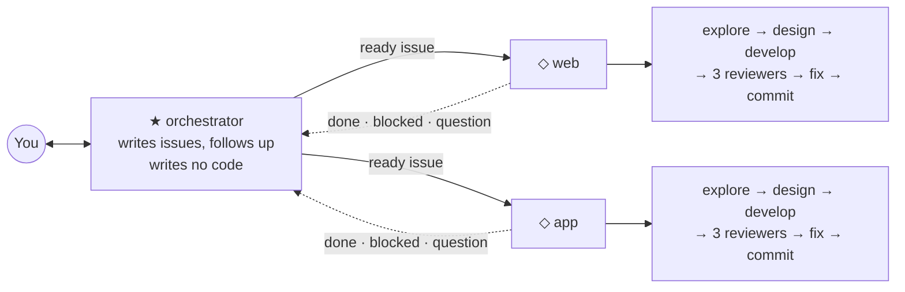

# SVOP

**Single owner. Very simple. Opinionated. Product development harness.**

You have an idea and you know what you want to make. You do not need a course, a server bootcamp or an "engineering factory" program first. Install this and start working.

SVOP gives you the superpowers that only command-line people have: a team of AI agents that writes the code, checks it, versions it and ships it, while you decide what gets built. It runs the author's own products every day.

<br>

## Start

You need a Mac or a Linux computer. Install Claude Code with one line in a terminal:

```sh
curl -fsSL https://claude.ai/install.sh | bash
```

Open a terminal in the folder for your project (an empty folder is fine), type `claude`, and paste this sentence:

> Install SVOP from &lt;repo-url&gt; and set up the harness for this project.

Claude installs the rest, asks you to log in to GitHub once, asks what you are making, and proposes how to split the work. Then you switch to the `★ orchestrator` tab and talk there. The steps it follows are in [INSTALL.md](INSTALL.md). You never need to read them.

<br>

## What changes for you

You keep the idea, the decisions and the looking. SVOP takes the rest.

| You do | SVOP does |
|---|---|
| Say what you want, in five words or a long voice note | Turns it into issues with a scope and a "done when" |
| Look at a design in the browser and say yes | Draws it, has a critic score it, fixes it before you see it |
| Answer the few questions only you can answer | Writes the code, each task in its own copy of the project |
| Read a one-line report | Runs three reviewers on every change and fixes what they find |
| Say "stop" when a task is not worth it | Versions, changelog, commit messages, cleanup of old copies and disk |
| Come back after days away | Remembers everything in flight; one summary catches you up |

<br>

## How it is built



You talk to one session, the `★ orchestrator`. It turns what you say into GitHub issues, sends each one to the team that owns that area, and tells you only what needs you. It writes no code.

Each `◇ team` owns one area of the project, such as the website or the app. It runs every issue through the same steps, with subagents doing the work: one explores, one designs, one critiques the design, one writes the code, and three review it from different sides. The teams answer to the orchestrator, never to you.

Every team runs in its own terminal tab. You can look into a `◇` tab at any time. You never have to.

<br>

## A day with SVOP

From the author's logs: five hours, about twenty messages from the owner, most of them under six words.

| | You | SVOP |
|---|---|---|
| 12:43 | Send a link: "check what I found" | Reads it and proposes the work |
| 12:46 | "go, do everything" | Opens two issues and sends them to two teams |
| 13:12 | A design opens in your browser | The critic has already scored it, three rounds |
| 13:13 | "design looks good to me" | The developer starts from the approved design |
| 13:25 | | A reviewer finds that a new tool copied the app's file readers; now both read the same code |
| 13:45 | | A reviewer finds a false green check: a failed permission check could still show "granted". Fixed before you see it |
| 13:52 | Your long voice note about version numbers | Becomes a script that computes the next version and refuses a typed one |
| 14:02 | Test one drag by hand for ten minutes, because no test can | Files the separate bug you found as its own issue |
| 14:04 | "onboarding went perfectly" | Lands the change and installs it; three changes by evening |

Every update ends in a table of tasks and a short list called "What only you can do". In another project the owner wrote "yes to all" to approve two plans at once, and "let him do it manually" to drop a task; every team stopped work on it within a minute.

<br>

## When it goes wrong

At 13:15 the owner wrote: "I can't use the app for dictations." The orchestrator had deleted a working copy of the project that the running app was launched from.

It replied "Sorry, the outage was my fault", restarted the app, and wrote a rule: before you delete a working copy, check that nothing running uses a file inside it. That rule now lives in [`worktrees.md`](rules/project/worktrees.md), and every team follows it.

It reports what did not work. A design that scored 7 out of 10 after three rounds went to the owner with the score shown, and the owner decided. An install waits while the owner is recording, because the harness never quits an app in use.

<br>

## It keeps itself tidy

Every correction you give becomes a rule in its own file, and every fact has one home. Lessons move out of short-term memory into rules, and old history stays in git, not in the instructions. The rule for this is [`knowledge.md`](rules/global/knowledge.md).

<br>

## What you accept

- **One owner.** SVOP is for one person who decides everything, not for a team of people.
- **GitHub.** Work is tracked as GitHub issues. Setup creates a private repository if the project has none.
- **No permission prompts in teams.** Teams run with `--permission-mode bypassPermissions` and auto-compact on, so they work without stopping to ask. The orchestrator keeps your own settings.
- **No options.** It is instructions for Claude Code in a few markdown files. If a rule does not fit, edit the file.

<br>

## Files

```
INSTALL.md          the steps Claude follows to install SVOP
agents/             six subagents             → ~/.claude/agents/
rules/global/       pipeline, design, issues, knowledge → ~/.claude/rules/
rules/project/      teams, worktrees          → <your project>/.claude/rules/
```

The agents are `developer`, `code-reviewer`, `bloat-reviewer`, `ponytail-reviewer`, `designer` and `design-critic`, plus Claude Code's built-in `Explore`.
