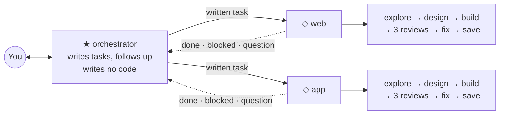

# SVOP

**Single owner. Very simple. Opinionated. Product development harness.**

You have an idea and you know what you want to make. You do not need a course first. Install this and start working.

A harness is a set of written instructions that turns Claude Code into a small team of AI agents. They write the code, check it and ship it. You decide what gets built.

SVOP is the setup its author builds and ships their own products with, every day.

<br>

## Start

SVOP is tested on macOS. It needs a paid Claude subscription that includes Claude Code (Pro or Max). Several teams working at once use more of the plan's limit, so Max suits daily work.

Open the Terminal app and paste this line. It downloads and installs Claude Code:

```sh
curl -fsSL https://claude.ai/install.sh | bash
```

Create a folder for your project (an empty folder is fine). In the terminal, type `cd `, drag the folder onto the window, and press Enter. Then type `claude` and paste this sentence:

> Install SVOP from https://github.com/atarazevich/svop and set up the harness for this project.

Claude installs the other tools it needs and asks you to log in to GitHub once. It asks what you are making and proposes how to split the work.

One of those tools is herdr, a terminal app that shows each Claude session as a tab. When setup is done, you switch to the `★ orchestrator` tab and talk there. The steps Claude follows are in [INSTALL.md](INSTALL.md). You never need to read them.

<br>

## What changes for you

You keep the idea and the decisions, and you judge the results by looking at them. The harness does the rest.

| You do | The harness does |
|---|---|
| Say what you want, in five words or a long voice note | Turns it into written tasks, each with a scope and a "done when" |
| Look at a design in the browser and say yes | Draws it, has a critic score it, fixes it before you see it |
| Answer the few questions only you can answer | Writes the code, each task in its own copy of the project |
| Read a one-line report | Has every change checked by three reviewers and fixes what they find |
| Say "stop" when a task is not worth it | Version numbers, release notes, saving the work, cleaning up old copies and disk |
| Come back after days away | Keeps every open task written down; one summary catches you up |

<br>

## How it is built



You talk to one Claude session, the `★ orchestrator`. It turns what you say into written tasks on GitHub and sends each one to the right team. It tells you only what needs you, and it writes no code.

Each `◇ team` is another Claude session that owns one area of the project, such as the website or the app. Every task goes through the same steps, done by helper agents the team starts. One explores, one designs, one scores the design, one writes the code, and three review it.

The teams answer to the orchestrator, never to you. You can look into a `◇` tab at any time. You never have to.

<br>

## A day with SVOP

From the author's logs: one day of five hours, with about twenty messages from the owner. Most of them were under six words.

| | You | The harness |
|---|---|---|
| 12:43 | Send a link: "check what I found" | Reads it and proposes the work |
| 12:46 | "go, do everything" | Writes two tasks and sends them to two teams |
| 13:12 | A design opens in your browser | The critic has already scored it, over three rounds |
| 13:13 | "design looks good to me" | Building starts from the approved design |
| 13:15 | "I can't use the app for dictations" | Finds its own mistake and fixes it (see below) |
| 13:25 | | A reviewer finds the same code written twice; it is merged into one |
| 13:45 | | A reviewer finds the app could say "permission granted" when it was not. Fixed before you see it |
| 13:52 | Your long voice note about version numbers | Becomes a script that picks the next version number by itself |
| 14:02 | Test one drag by hand for ten minutes, because no test can | Writes the separate bug you found as its own task |
| 14:04 | "onboarding went perfectly" | The new version is installed on your Mac; three changes are done by evening |

Every update ends in a table of tasks and a short list called "What only you can do". In another project the owner wrote "yes to all" to approve two plans at once. Later they wrote "let him do it manually" to drop a task, and every team stopped work on it within a minute.

<br>

## When it goes wrong

At 13:15 that same day the owner wrote: "I can't use the app for dictations." The orchestrator had deleted a copy of the project that the running app was started from.

It replied "Sorry, the outage was my fault" and restarted the app. Then it wrote a rule: before you delete a copy of the project, check that no running program uses it. That rule is now in [`worktrees.md`](rules/project/worktrees.md), and every team follows it.

It also reports what did not work. A design that scored 7 out of 10 after three rounds went to the owner with the score shown. The owner decided.

An install waits while the owner is recording. The harness never quits an app that is in use.

<br>

## How the instructions stay small

Every correction you give becomes a rule in its own file. Every fact has one home, and other files point to it.

Lessons that will still hold next month move into rules. History stays in GitHub, not in the instructions. The rule for this is [`knowledge.md`](rules/global/knowledge.md).

<br>

## What you accept

- **One owner.** SVOP is for one person who decides everything, not for a team of people.
- **GitHub.** Tasks are kept on GitHub. Setup creates a private GitHub project for your folder if it has none.
- **Teams act without asking.** Teams run commands and change files without asking you first. Each one works in a separate copy of the project.
- **Three reviews first.** A change reaches the main version of your project only after three reviews. The orchestrator keeps your own permission settings and asks as usual.
- **No options.** SVOP is a few plain text files. If a rule does not fit, edit the file.

<br>

## What it changes on your computer

In `~/.claude/`, the folder Claude Code reads on every project, it adds six agent files and four rule files. A file of yours with the same name is kept as `<name>.md.bak`.

In your project, it adds two files under `.claude/rules/`, a `CLAUDE.md` if there is none, and two task labels on GitHub. It also installs herdr and GitHub's `gh` tool if they are missing.

**Remove it:** delete the files listed below from `~/.claude/` and from your project's `.claude/rules/`. Then rename any `.bak` file back to its old name.

<br>

## Files

```
INSTALL.md          the steps Claude follows to install SVOP
agents/             six agents → ~/.claude/agents/
                    developer, code-reviewer, bloat-reviewer,
                    ponytail-reviewer, designer, design-critic
rules/global/       four rules → ~/.claude/rules/
                    development-workflow, design-workflow,
                    github-issues, knowledge
rules/project/      two rules  → <your project>/.claude/rules/
                    team, worktrees
```

<br>

MIT License. See [LICENSE](LICENSE).
